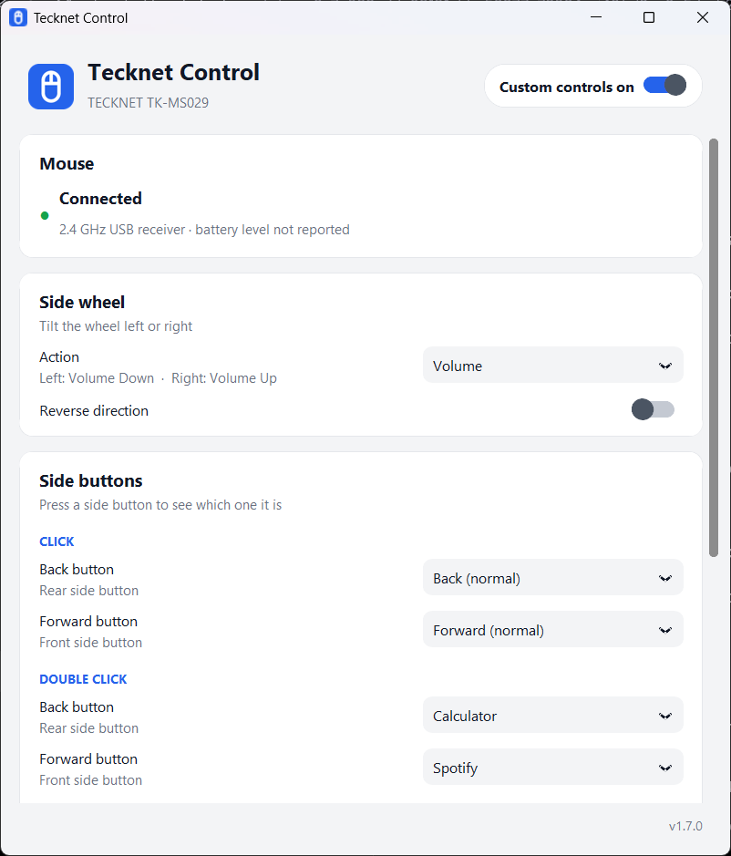
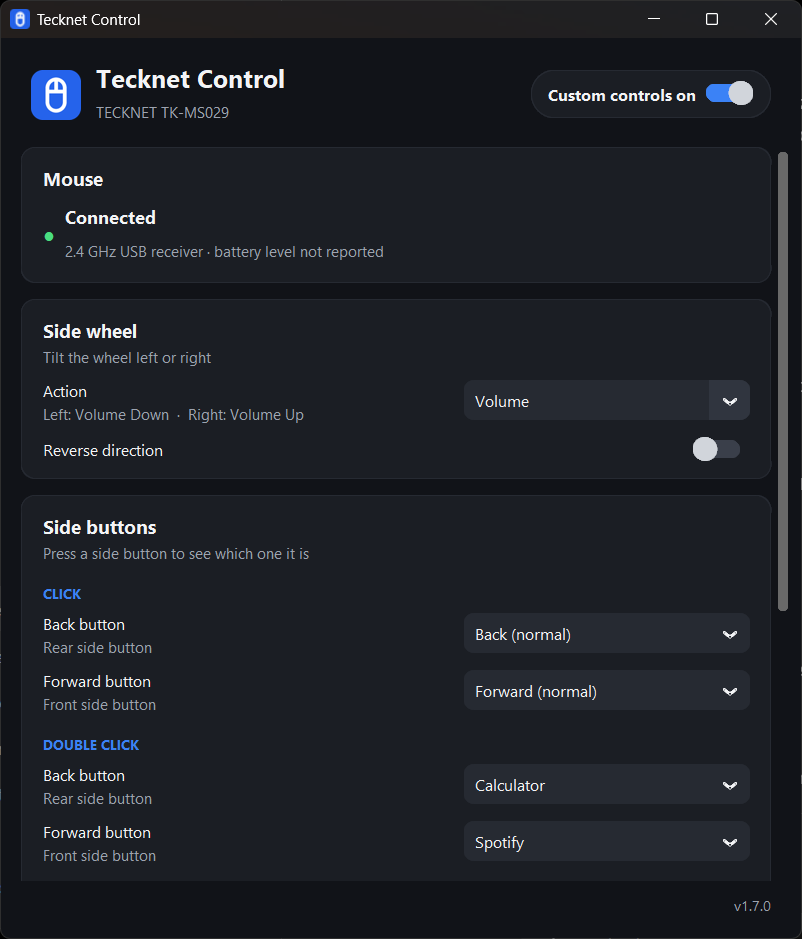

# Tecknet Control

A small Windows app for the **TECKNET TK-MS029** mouse. It gives the side wheel
and the side buttons useful jobs (volume, tabs, media, zoom, opening apps)
and shows the connection and battery level.

<p>
  
  
</p>

## Features

- **Side wheel**: Volume, Navigate Tabs, Media Tracks, Zoom (Ctrl + wheel),
  Virtual Desktops, or plain Horizontal Scroll. The direction can be reversed.
- **Only your mouse**: the wheel action applies to the TECKNET mouse only.
  Trackpads and other mice keep normal horizontal scrolling.
- **Side buttons**: choose what the Back and Forward buttons do on a click
  and on a double click: open any app, send any keyboard shortcut, or an
  action such as Play / Pause, Mute, Task View, Show Desktop or Screenshot.
  Press a side button and its rows light up in the window, so you know which
  is which. The double-click wait is adjustable.
- **Device status**: Bluetooth connection with battery level, and the
  2.4 GHz USB receiver (shown as connected only while the mouse is in use).
  Optional notification when the battery is low.
- **Tray icon**: open the window, switch custom controls on or off, exit.
- System, Light and Dark themes. Start with Windows. Keep running when the
  window is closed.
- Turning custom controls off, or exiting, gives the mouse back its normal
  behaviour straight away.

## Install

Download `TecknetControl-Setup-<version>.exe` from
[Releases](../../releases) and run it. It installs for your user only
(no administrator rights), in `%LOCALAPPDATA%\Programs\Tecknet Control`, with
a Start menu shortcut and an optional desktop shortcut and start-up entry.
Uninstall from Windows Settings → Apps.

Nothing else is needed: no Python, no AutoHotkey.

## Privacy and safety

- No telemetry, no network access, no administrator rights.
- Settings are stored only on your PC, in `%APPDATA%\TecknetControl\settings.json`
  (kept when you update or uninstall).
- Apps opened by the side buttons must be existing local `.exe` or `.lnk`
  files you chose; they are started directly, never through a command line.

## How it works

The app listens to the mouse with a Windows low-level mouse hook and with
Raw Input, which tells it which device sent each event. A side-wheel tilt
from the TECKNET mouse runs the chosen action; anything else passes through
untouched. The hook is installed only while custom controls are on, and
Windows removes it automatically if the app closes or crashes.

| File | What it does |
|---|---|
| `tecknet_control/app.py` | main window |
| `tecknet_control/ui/` | look (`theme.py`), side wheel and button cards, app picker, shortcut recorder |
| `tecknet_control/actions.py` | list of actions and wheel presets (add new ones here) |
| `tecknet_control/engine.py` | decides what each wheel tilt or click does (no Windows calls; tested) |
| `tecknet_control/input_hook.py` | mouse hook, Raw Input, timers |
| `tecknet_control/devices.py` | Bluetooth connection, battery, USB receiver |
| `tecknet_control/config.py` | settings and their defaults |
| `tecknet_control/system.py` | single instance, start with Windows, clean-up of v1.6 |

## Run from source

Requires Windows 10 or 11 and Python 3.11 or newer.

```bat
install.bat
run.bat
```

Run the tests with `py -m unittest discover -s tests -t .`.
For a bug report, start the app with `--debug`: every side-wheel event is then
written to `%APPDATA%\TecknetControl\tecknet_control.log`.

## Build

```bat
build.bat
```

This runs the tests, builds `dist\TecknetControl\` with PyInstaller and, if
[Inno Setup 6](https://jrsoftware.org/isinfo.php) is installed, the installer
`dist\TecknetControl-Setup-<version>.exe`.

## Other mice

The app is made for the TK-MS029, but the controls work with any mouse that has
a horizontal wheel or side buttons: under *App*, choose *Add mouse* and tilt
its wheel. Connection and battery status are shown for the TK-MS029 only.

## License

[MIT](LICENSE). Not affiliated with TECKNET.
